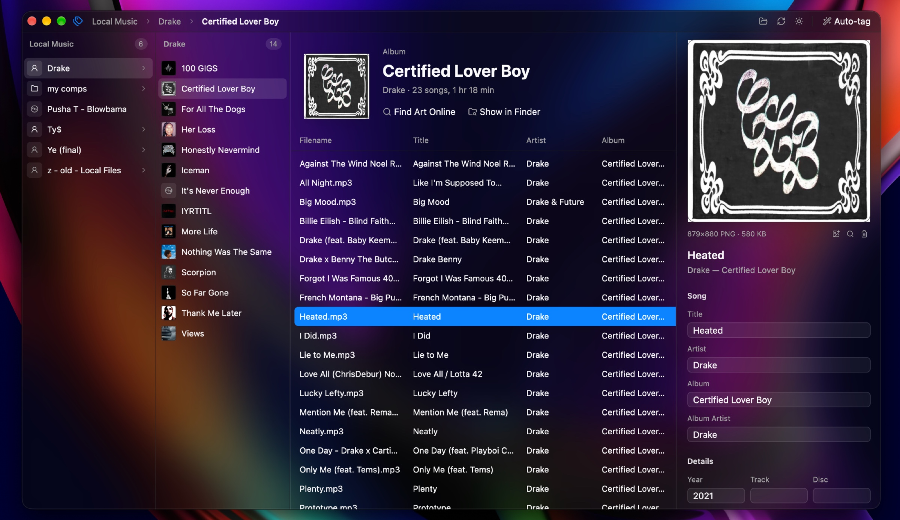

# easytag

The best way to manage and tag your local music library.



## Features

**Browse**
- Finder-style columns: `Music › Artist › Album`
- Album header with cover, artist, year and length

**Edit**
- Mp3tag-style: edit one song or many at once
- Differing values show `< keep >`
- Title, Artist, Album, Year, Track, Genre, Explicit and more
- Rename files from the tag panel

**Auto-tag** (⌘⇧T)
- Artist and Album from your folders
- Title and Track from file names
- Missing art, year and genre from iTunes or MusicBrainz

**Folder roles**
- Folders are guessed as Artist, Album or Neither
- Right-click to change
- Your picks overwrite tags; guesses only fill blanks

**Album art**
- Saved as `cover.jpg` in the album folder
- New songs in that folder get it automatically

**Files**
- Drag to move songs and folders
- New folder, rename and Move to Trash from the right-click menu
- ⌘Z undoes moves and trashes
- Never overwrites files or drops unknown tags

**Formats:** MP3, FLAC, M4A, Ogg, Opus, WAV, AIFF, APE, WavPack, Musepack

## Shortcuts

| | |
|---|---|
| ⌘O | Open folder |
| ⌘S / Return | Save |
| ⌘R | Reload |
| ⌘⇧T | Auto-tag |
| ⌘Z | Undo move or trash |
| ⌘⌫ | Move to Trash |
| Esc | Clear selection |

## Build

Needs [Rust](https://rustup.rs).

```sh
cargo run --release     # run
./scripts/bundle.sh     # build dist/easytag.app
cargo test              # test
```

## Credits

[GPUI](https://gpui.rs) · [GPUI Kit](https://github.com/longbridge/gpui-kit) · [lofty](https://github.com/Serial-ATA/lofty-rs) · [MusicBrainz](https://musicbrainz.org) · [Cover Art Archive](https://coverartarchive.org) · [Lucide](https://lucide.dev)
